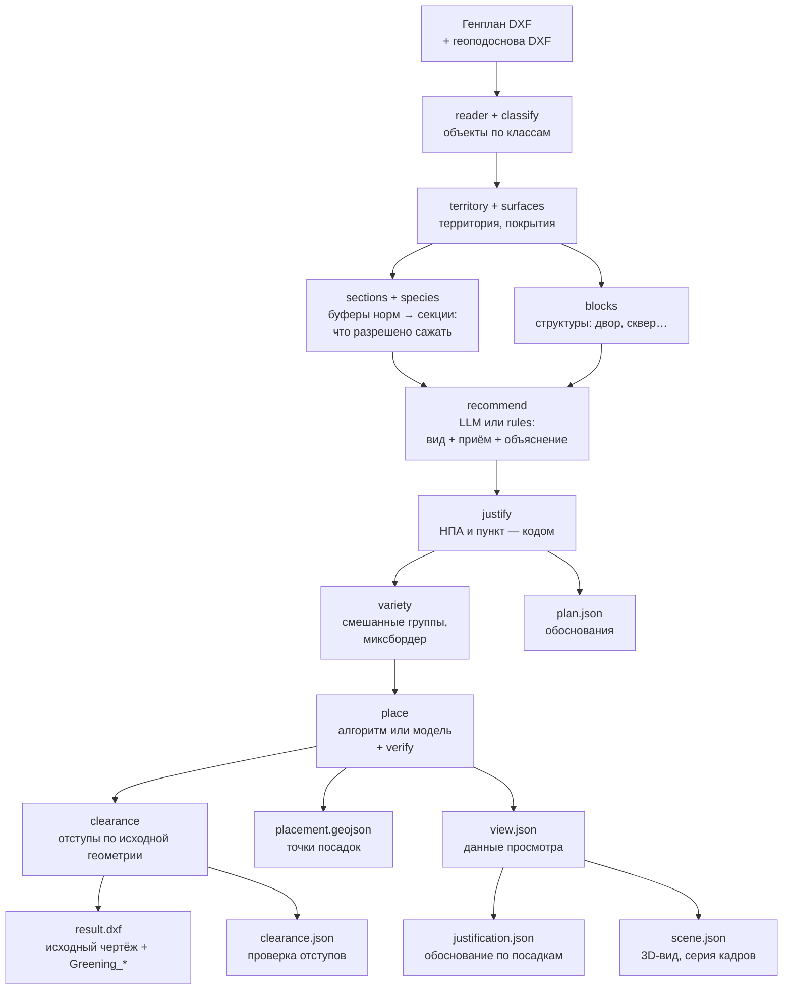
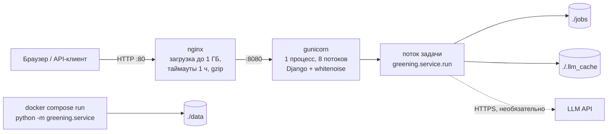
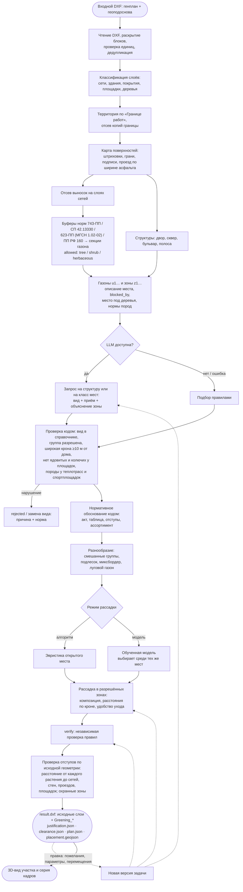

# Сервис озеленения по генплану — документация

ЛЦТ 2026, кейс 03: «Сервис для автоматического проектирования озеленения города с учётом расположения подземных коммуникаций и городской среды».

Содержание:
1. [Архитектура](#1-архитектура)
2. [Развёртывание](#2-развёртывание)
3. [HTTP API](#3-http-api)
4. [Пояснительная записка](#4-пояснительная-записка)

---

## 1. Архитектура

### 1.1. Компоненты

| Компонент | Где | Что делает |
|---|---|---|
| Конвейер `greening` | `greening/` | Модуль Python без зависимости от Django: DXF → разметка → подбор растений → рассадка → проверка → DXF. Запускается из CLI (`python -m greening.service`) и из веб-сервиса. |
| Веб-сервис | `config/`, `core/` | Django: загрузка, фоновые задачи, выдача результатов, просмотр, редактирование, 3D-вид, Swagger UI. |
| Фоновые задачи | `core/jobs.py` | Поток на задачу, одновременно считается одна (`GREENING_JOBS`). Состояние — `jobs/<id>/status.json`, результаты — `jobs/<id>/out/`. Правка результата — новая задача-версия (`parent`). |
| Просмотр | `core/static/core/viewer.js` | Полноэкранная карта результата: два режима («План посадок», «Где можно сажать»), карточки структур, газонов, посадок и зон с обоснованиями. |
| Редактор | `core/static/core/editor.js` | Окно «Изменить»: пожелания к растениям, параметры рассадки, перетаскивание и поворот растений и групп. |
| 3D-вид | `core/static/core/scene.js`, `greening/scene.py` | Объёмная сцена участка после озеленения (Three.js): дома вокруг, существующие и новые деревья, кусты, цветники по сезонам; серия кадров для отчёта. |
| Справочники и нормы | `greening/config/` | `layers.json` — классы слоёв DXF; `norms.json` — нормативные отступы и правила для пород; `placement.json` — правила рассадки; `plants.txt`, `herbaceous.csv` — справочник растений (383 вида); `scene.json` — вид растений в 3D. |
| Модель рассадки | `greening/models/placement.npz` | Обучена на посадках проектировщиков пилотного набора; выбирает места внутри разрешённых зон. |
| LLM (внешняя, необязательна) | OpenAI-совместимый API | Подбор видов и текст обоснования по структуре. Без ключа или сети подбор делают правила (`greening/rules.py`). |
| Кэш LLM | `.llm_cache/` | Ответы по хэшу запроса: повторный прогон того же чертежа не тратит токены. |

### 1.2. Модули конвейера

| Модуль | Назначение |
|---|---|
| `reader.py` | Чтение DXF с раскрытием блоков, проверка единиц на правдоподобие, удаление дубликатов между генпланом и геоподосновой. |
| `classify.py` | Класс каждого слоя (сеть, здание, бортовой камень, покрытие, дерево…), покрытия штриховок, подписи; демонтируемое не учитывается. |
| `territory.py` | Территория по «Границе работ»: закрытие разрывов до 2 м, внутренние контуры — дыры; копии границы для листа или схемы (части без подосновы) отбрасываются. |
| `surfaces.py` | Карта поверхностей: штриховки, грани линий, подписи («ГАЗОН», «А», «ДЕТ.ПЛ.»), распознавание домов; проезжая часть в топосъёмке без штриховок — по ширине асфальта. |
| `structures.py` | Площадки, малые формы, существующие деревья и ряды деревьев. |
| `leaders.py` | Отсев выносок подписей на слоях сетей — они не дают отступов. |
| `sections.py` | Секции газона: нормативные буферы из `norms.json`, для каждой секции — что разрешено (`tree` / `shrub` / `herbaceous`) и какие нормы сработали. |
| `species.py` | Нормы для отдельных пород (у теплотрасс, у спортплощадок): где вид нельзя ставить ближе нормы. |
| `blocks.py` | Структуры территории: двор, сквер, бульвар, полоса вдоль улицы. |
| `recommend.py` | Подбор растений LLM: запрос на структуру (или на класс мест), проверка ответа кодом, замены. |
| `rules.py` | Подбор растений правилами — запасной путь без LLM. |
| `justify.py` | Нормативная часть обоснования — пишется кодом, не моделью. |
| `variety.py` | Разнообразие: смешанные группы, подлесок, миксбордер, луговой газон. |
| `params.py` | Параметры рассадки (50): схема для формы и API, проверка значений, применение к `placement.json`. |
| `place.py` | Рассадка в разрешённых зонах, композиция (группы, изгороди, ряды, солитеры, цветники), удобство ухода, ручные перемещения, независимая проверка `verify()`, запись DXF. |
| `model.py` | Модель рассадки: признаки места, обучение на посадках проектировщиков, оценка точек (режим `model`). |
| `clearance.py`, `annotate.py` | Проверка отступов по исходной геометрии; служебные слои DXF (зоны, номера, пометки). |
| `export.py`, `view.py` | GeoJSON разметки, данные для просмотра, `justification.json`. |
| `scene.py` | Данные 3D-сцены. |
| `service.py` | Весь конвейер одним вызовом, этапы для индикатора хода, пересчёт версий. |
| `split.py` | Выгрузка DXF + JSON по каждой структуре (подготовка данных для модели). |

### 1.3. Поток данных



Файлы результата (`<папка>/`):

| Файл | Содержимое |
|---|---|
| `result.dxf` | Исходный чертёж без изменений + слои `Greening_Деревья`, `Greening_Кустарники`, `Greening_Кустарники_места`, `Greening_Травянистые`, `Greening_Цветники`, `Greening_Газон`; зоны допустимости `Greening_Зоны_Деревья_Кустарники`, `Greening_Зоны_Кустарники`, `Greening_Зоны_Травянистые`, `Greening_Зоны_Запрет` (и `Greening_Зоны_Деревья`, если такие зоны есть); номера зон с причинами запретов `Greening_Зоны_Номера`; посадки в охранных зонах сетей `Greening_Согласование`; нарушения отступов `Greening_Нарушения` (только если они есть) |
| `clearance.json` | **Проверка отступов** по исходной геометрии чертежа, без зон разметки: у каждого растения (номер `R00001`…) — расстояния до ближайших нормируемых объектов с нормой, слоем и пунктом акта; нарушения; посадки в охранных зонах сетей (нужно согласование); пометки о линиях, которые фильтр счёл выносками |
| `justification.json` | **Обоснование для выгрузки** — то же, что карточки просмотра: по каждой структуре замысел и сезонность; по каждой посадке растение, группа, приём, количество, обоснование, нормы, свойства, предупреждения, кем решено, замена вида; по каждой зоне место, решение, условия, что закрыло деревья и кустарники; отклонённые посадки с причиной |
| `plan.json` | Структуры → газоны → зоны; посадки с обоснованием (`reason`, `norms`, `facts`, `warnings`), отклонённые посадки (`rejected`), объяснение каждой зоны, `blocked_by` |
| `placement.geojson` | Точки растений, контуры групп и изгородей, пятна цветников и газона, сводка и число нарушений |
| `greening.geojson` | Разметка: территория, поверхности, секции с разрешениями и нормами, структуры |
| `obstacles.pkl` | Нормируемые объекты для проверки отступов и пересчёта версий без новой разметки |
| `view.json` | Данные интерактивного просмотра |
| `scene.json` | Данные 3D-вида (строится при первом открытии) |
| `summary.json` | Итог: площади, структуры, зоны, растения, токены, режим рассадки, параметры, нарушения правил рассадки, `clearance_violations`, `clearance_checked`, `clearance_approvals` |

### 1.4. Схема развёртывания



Два контейнера (`docker-compose.yml`): `greening` (образ из `Dockerfile`, Python 3.13-slim) и `nginx` (`nginx:1.27-alpine`, конфигурация `deploy/nginx.conf`). Один процесс gunicorn — потому что очередь задач и отмена живут в памяти процесса; фоновая задача — поток внутри него. Тома: `./jobs` (задачи переживают пересоздание контейнера), `./.llm_cache` (кэш LLM), `./data` (файлы для CLI).

---

## 2. Развёртывание

### 2.1. Требования

- Docker с Compose v2 (Linux, в том числе МосТех.ОС/Ubuntu, или Docker Desktop).
- Память: 4 ГБ для генплана среднего размера (десятки МБ), 16 ГБ и больше — для крупных (Олимпийская деревня, 187 МБ + 158 МБ).
- Сеть — только для LLM, первой сборки образа и страницы Swagger UI (грузится с CDN). Без сети сервис работает на правилах.

### 2.2. Docker (основной способ)

```bash
git clone https://github.com/LPN1KoL/Hackaton.git && cd Hackaton
# необязательно: ключ LLM — файл .env в корне
#   BASE_URL=https://адрес-api/v1
#   API_KEY=ваш-ключ
docker compose up -d --build        # сборка ~6 минут
```

Сервис: `http://<адрес машины>/`, Swagger UI: `http://<адрес машины>/docs/`.

Переменные окружения (в `.env` или в окружении перед `docker compose up`):

| Переменная | По умолчанию | Назначение |
|---|---|---|
| `BASE_URL`, `API_KEY` | — | OpenAI-совместимый API для подбора растений; без них — правила |
| `LLM_MODEL` | встроенное значение | Модель LLM |
| `SUB_BASE_URL`, `SUB_API_KEY`, `SUB_MODEL` | как основные | Запасная модель, если основная не ответила |
| `GREENING_LLM` | `1` | `0` — всегда правила, без сети |
| `GREENING_LLM_WORKERS` | `5` | Параллельных запросов к LLM |
| `GREENING_PLACEMENT` | `algorithm` | Режим рассадки по умолчанию: `algorithm` — эвристика, `model` — обученная модель (растения в обоих режимах — только в разрешённых нормами зонах). В вебе режим выбирается на стартовой странице (поле `placement` в `/upload/`), в CLI — `--placement` (по умолчанию `algorithm`) |
| `GREENING_JOB_ABANDON_S` | `180` | Через сколько секунд без опроса статуса задача отменяется |
| `DJANGO_SECRET_KEY` | заглушка | Обязательно сменить для публичного адреса |
| `DJANGO_ALLOWED_HOSTS` | `*` | Имена/адреса, по которым открывают сервис |
| `DJANGO_CSRF_TRUSTED_ORIGINS` | — | Нужна при работе через HTTPS, например `https://greening.example.ru` |

### 2.3. МосТех.ОС (Linux, близка к Ubuntu)

```bash
# 1. Docker и Compose (если не установлены)
sudo apt-get update
sudo apt-get install -y docker.io docker-compose-v2 git   # или docker-ce + docker-compose-plugin из репозитория Docker
sudo usermod -aG docker $USER && newgrp docker

# 2. Код и запуск
git clone https://github.com/LPN1KoL/Hackaton.git greening && cd greening
docker compose up -d --build
docker compose ps                       # оба контейнера — running

# 3. Прогон DXF и результат
mkdir -p data && cp ~/Генплан.dxf ~/Геоподоснова.dxf data/
docker compose run --rm greening python -m greening.service /data/Генплан.dxf \
    --geobase /data/Геоподоснова.dxf --out /data/result
ls data/result                          # result.dxf, justification.json, clearance.json, plan.json, placement.geojson, summary.json, view.json
```

Веб-интерфейс — `http://localhost/` (или адрес машины), Swagger — `http://localhost/docs/`. `data/result/result.dxf` открывается в nanoCAD или другом DXF-просмотрщике под Linux. Если порт 80 занят, поменяйте `"80:80"` в `docker-compose.yml`, например на `"8080:80"`.

### 2.4. Прогон из командной строки в контейнере

Файлы кладутся в `./data`, в контейнере это `/data`:

```bash
docker compose run --rm greening python -m greening.service /data/Генплан.dxf \
    --geobase /data/Геоподоснова.dxf --out /data/result \
    [--no-llm] [--placement algorithm|model] [--seed N] [--limit N] [--preferences "…"] [--markup-from ПАПКА]
```

Результат — в `./data/result/` (см. таблицу файлов в 1.3). В конце команда печатает сводку JSON.

Параметризация и повторный прогон:
- `--placement model` — места выбирает обученная модель, `algorithm` — эвристика;
- `--seed N` — другой вариант рассадки при тех же нормах (тот же seed — тот же результат);
- `--no-llm` — подбор правилами;
- `--limit N` — в LLM только N крупнейших структур;
- `--preferences "…"` — пожелания к растениям текстом (уходят в запрос LLM);
- `--markup-from ПАПКА` — разметка из прежнего результата, без повторного разбора чертежа;
- `greening/config/norms.json`, `placement.json`, `layers.json` — нормы, правила рассадки и классы слоёв (правка без изменения кода).

### 2.5. Проверка

1. Статус задачи — `done`, в `summary.json` поле `violations` равно `0` (независимая проверка рассадки `place.verify`), `clearance_violations` — `0` (проверка отступов по исходной геометрии).
2. `result.dxf` открывается в nanoCAD / LibreCAD / любом DXF-просмотрщике: исходные слои на месте и не изменены, слои `Greening_*` включаются и выключаются отдельно.
3. `justification.json`: у каждой посадки есть `нормы` со ссылкой на акт и таблицу/пункт, у каждой зоны — объяснение.
4. Автотесты (94): `python -m unittest discover greening/tests` (в контейнере: `docker compose run --rm greening python -m unittest discover greening/tests`).

### 2.6. Локальный запуск без Docker

Пошагово — в `README.md`, раздел «Локальный запуск». Кратко: Python 3.13, `pip install -r requirements.txt`, `python manage.py runserver 127.0.0.1:8080 --noreload` или `python -m greening.service …`.

---

## 3. HTTP API

Спецификация OpenAPI 3 — `core/static/core/openapi.json`, Swagger UI — `GET /docs/` (развёрнутый стенд: http://158.160.223.108/docs/). Кнопка «Try it out» в Swagger UI вызывает методы без дополнительной настройки.

### 3.1. Методы

| Метод | Путь | Назначение | Ответы |
|---|---|---|---|
| `POST` | `/upload/` | Загрузить генплан и запустить обработку | `202`, `400` |
| `GET` | `/jobs/{job}/` | Состояние и ход обработки | `200`, `404` |
| `GET` | `/jobs/{job}/{kind}/` | Результат: `dxf`, `report`, `clearance`, `plan`, `placement`, `view` | `200`, `404` |
| `POST` | `/jobs/{job}/cancel/` | Отменить задачу | `202`, `404` |
| `POST` | `/jobs/{job}/revise/` | Пересчитать готовый результат: пожелания к растениям и/или параметры рассадки (новая задача-версия) | `202`, `400`, `404`, `409` |
| `POST` | `/jobs/{job}/move/` | Сохранить перемещения растений (новая задача-версия, рассадка не пересчитывается) | `202`, `400`, `404`, `409` |
| `GET` | `/params/` | Параметры рассадки: ключи, группы, пределы, значения по умолчанию | `200` |
| `GET` | `/jobs/{job}/scene/` | Данные 3D-вида (JSON) | `200`, `404` |
| `GET` | `/jobs/{job}/3d/` | Страница 3D-вида | `200`, `404` |
| `POST` | `/preview/` | SVG-превью чертежа (без обработки) | `200`, `400` |
| `GET` | `/docs/` | Swagger UI | `200` |
| `POST` | `/docs/` | Спецификация OpenAPI в JSON | `200` |

### 3.2. `POST /upload/`

`multipart/form-data`:
- `file` — генплан, DXF (обязательно);
- `geobase` — геоподоснова, DXF (необязательно);
- `placement` — режим рассадки: `algorithm` (по умолчанию) или `model`;
- `preferences` — пожелания к подбору растений, текст до 2000 символов (необязательно), см. 3.5.

Файл проверяется по расширению `.dxf` и по содержимому (сигнатура бинарного DXF или `SECTION` в первом килобайте).

```json
202 {"job": "3f2c…e1", "name": "Генплан.dxf", "size": 54012345}
400 {"errors": {"file": ["…"]}}
```

### 3.3. `GET /jobs/{job}/`

```json
{
  "state": "running",            // queued | running | done | error | cancelled
  "stage": "llm",                // markup | llm | placement | dxf | view
  "stage_title": "Подбор растений",
  "done": 4, "total": 12,        // на этапе llm — структуры
  "name": "Генплан.dxf",
  "summary": { … },              // при done — как summary.json
  "error": "…"                   // при error / cancelled
}
```

Опрашивайте статус не реже раза в `GREENING_JOB_ABANDON_S` (180 с): задача без опросов считается брошенной и отменяется.

### 3.4. `GET /jobs/{job}/{kind}/`

| `kind` | Файл | Тип | Скачивается как |
|---|---|---|---|
| `dxf` | `result.dxf` | `image/vnd.dxf` | `<имя>_озеленение.dxf` |
| `report` | `justification.json` | `application/json` | `<имя>_обоснование.json` |
| `clearance` | `clearance.json` | `application/json` | `<имя>_проверка_отступов.json` |
| `plan` | `plan.json` | `application/json` | `<имя>_план.json` |
| `placement` | `placement.geojson` | `application/geo+json` | `<имя>_рассадка.geojson` |
| `view` | `view.json` | `application/json` | — |

`404`, пока задача не в состоянии `done`. Данные 3D-вида — отдельный путь `GET /jobs/{job}/scene/`.

### 3.5. Редактирование результата

Требование ТЗ (п. 6 «Что должен уметь сервис») закрыто на трёх уровнях. Каждая правка — новая задача-версия: исходная задача не меняется, у новой в статусе `parent`; правки — только на слоях результата.

**Уровень 1 — пожелания** (`POST /jobs/{job}/revise/`, поле `preferences`, форма или JSON, до 2000 символов). Нет поля — пожелания прежние, пустое — пожелания сняты. Разметка берётся из исходной задачи (`greening.geojson`, `obstacles.pkl`) и не считается заново; заново идут подбор растений, рассадка, проверка отступов, DXF и обоснования. Пожелание уходит в каждый запрос к LLM отдельным блоком с указанием: нормы, условия зон и свойства справочника важнее пожеланий; в обосновании структуры LLM пишет, что учтено и что нельзя. Ответ проверяется кодом так же, как без пожеланий, поэтому текст не может вывести посадку за нормы. Пожелание «без хвойных» отключает добавление хвойного акцента. Без LLM пожелание не учитывается — в сводке `preferences_note`. Пересчёт нового генплана — около 30 с без разметки плюс время LLM.

**Уровень 2 — параметры рассадки** (`POST /jobs/{job}/revise/`, поле `params` — объект `{ключ: значение}`, в форме — JSON-строкой). Список, пределы, шаги, единицы и значения по умолчанию — `GET /params/`. Если пожелания не менялись, подбор растений берётся из исходной задачи и LLM не вызывается (`plan_reused` в сводке): пересчитываются рассадка, проверка отступов, DXF и обоснования. Параметры накапливаются по версиям: новые поверх параметров исходной задачи. `verify()` проверяет рассадку по тем же параметрам; нормы параметрами не меняются — растения по-прежнему только в разрешённых зонах.

| Группа | Параметры (ключ) | Режим |
|---|---|---|
| Способ рассадки | `placement` (model / algorithm); `seed` — вариант рассадки (только в API и CLI, в форме его нет) | оба |
| Сколько сажать | `shrub_cover_landscape/formal` — насыщенность кустарником, `bed_share`, `bed_max_m2` — цветник, `tree_max_per_100m2` — предел деревьев, `solitary_max_tree/shrub` — одиночных на зону не больше | оба |
| Группы | `group_sizes_small/medium/large/tree` — варианты размера групп, `drift_landscape/formal` — доля вытянутых куртин, `jitter_landscape/formal` — неровность групп | оба |
| Разнообразие | `mixed_share` — группы из двух видов кустов, `underplanting_share` — кусты под новыми деревьями, `height_grading`, `grading_depth_m` — низкие ближе к дорожке, `mixborder_species`, `mixborder_min_m2` — цветник из нескольких видов, `meadow_border_m` — полоса обычного газона у дорожек при луговом | оба |
| Плотность и просветы | `shrub_share` — кучность кустов в группе (× кроны), `group_gap_m` — зазор между группами, `tree_unit_spacing_m` — просвет между деревьями и группами, `hedge_share`, `hedge_max_m` — шаг изгороди, `tree_spacing_m`, `tree_row_spacing_m` — шаг деревьев в группе и ряду | оба |
| Удобство ухода | `access_path_reach` — куст не дальше от дорожки, `access_lone_edge` — одиночный куст не дальше от края газона, `access_road_only` — у проезда только при дорожке рядом, `access_mow_min` — без узких полосок газона у края | оба |
| Существующие деревья | `existing_clearance_tree/shrub` — отступ новых от ствола | оба |
| Стиль | `style_mode` (auto / landscape / formal), `landscape_share_<тип>` — доля пейзажного по типу территории | оба |
| Модель | `model_temperature` — разброс выбора мест, `model_min_score_tree/shrub` — разборчивость, `model_group_variants` — вариантов места группы | модель |
| Алгоритм | `edge_pull_landscape/formal` — тяга к середине (+) или к краю (−) газона | алгоритм |

```json
POST /jobs/3f2c…e1/revise/
{"params": {"placement": "model", "tree_unit_spacing_m": 12, "group_sizes_small": [3, 5], "style_mode": "landscape"}}
400 {"errors": {"params.shrub_share": ["«Кучность кустов в группе»: от 0.4 до 1.5"]}}
```

```json
202 {"job": "9a1c…", "name": "Генплан.dxf", "size": 54012345, "parent": "3f2c…e1"}
400 {"errors": {"preferences": ["Напишите, какие растения предпочесть."]}}
409 {"errors": {"job": ["Исходная задача ещё не готова."]}}
```

**Уровень 3 — перемещения** (`POST /jobs/{job}/move/`, JSON `{"moves": [{"id": "R00012", "x": …, "y": …}]}`, координаты чертежа). Растения стоят там, куда их передвинули, рассадка не пересчитывается; заново — `verify()`, проверка отступов по чертежу, DXF, просмотр и обоснования. Перемещение не запрещается: растение вне разрешённой зоны попадает в «Нарушения правил», ближе нормы к сетям — в проверку отступов и слой `Greening_Нарушения`. Контур группы: группа сдвинута или повёрнута целиком — контур сдвигается и поворачивается вместе с ней, иначе строится заново по кронам. В сводке — `moved`.

**Порядок редактирования.** Пересчёт пожеланий или параметров строит рассадку заново, поэтому перемещения делаются последними: пожелания и параметры → «Пересчитать» → перемещения → «Сохранить перемещения» → DXF. Перемещать можно всегда; сайт предупреждает о порядке, а при пересчёте с несохранёнными перемещениями спрашивает подтверждение.

**В интерфейсе** — кнопка «Изменить» рядом с «Открыть просмотр» открывает окно с двумя вкладками; сверху — схема «разметка → подбор → рассадка»: что меняют пожелания и что параметры.
1. «Пожелания и параметры»: текст пожеланий и параметры наглядными элементами — ползунки (с «без предела» у пределов), переключатели-сегменты (режим, стиль), «фишки» размеров групп. У каждой группы — пояснение простым языком, редкие параметры — под «Тонкой настройкой»; изменённое подсвечено, кнопка «↺» возвращает значение по умолчанию; группы «Модель» и «Алгоритм» видны по выбранному режиму; кнопка «Пересчитать».
2. «Перемещение растений»: свой обзор участка (покрытия, зоны, существующие деревья, цветники, группы, растения); растение или группу целиком тащат мышью, Shift+перетаскивание или режим «повернуть группу» — поворот группы вокруг центра, колесо — масштаб; сдвинутое обведено синим, вне зоны, где вид разрешён, — красным; «Отменить шаг», «Вернуть всё», «Сохранить перемещения».

В сводке результата — «Пожелания», «Параметры рассадки: изменено N», «Подбор растений: прежний», «Перемещено вручную». CLI: `python -m greening.service ГЕНПЛАН.dxf --markup-from ПРЕЖНИЙ_РЕЗУЛЬТАТ --preferences "…"`.

### 3.6. CSRF

Django требует CSRF-токен на `POST`. Токен приходит в cookie `csrftoken` при открытии любой страницы и передаётся в заголовке `X-CSRFToken`. Пример полного цикла:

```bash
HOST=http://158.160.223.108
curl -s -c jar.txt $HOST/ -o /dev/null
TOKEN=$(awk '/csrftoken/ {print $7}' jar.txt)

JOB=$(curl -s -b jar.txt -H "X-CSRFToken: $TOKEN" \
  -F file=@Генплан.dxf -F geobase=@Геоподоснова.dxf -F placement=model $HOST/upload/ | python3 -c 'import sys,json;print(json.load(sys.stdin)["job"])')

while :; do
  STATE=$(curl -s $HOST/jobs/$JOB/ | python3 -c 'import sys,json;print(json.load(sys.stdin)["state"])')
  echo $STATE; [ "$STATE" = running ] || [ "$STATE" = queued ] || break; sleep 5
done

curl -s -o result.dxf $HOST/jobs/$JOB/dxf/
curl -s -o justification.json $HOST/jobs/$JOB/report/
curl -s -o clearance.json $HOST/jobs/$JOB/clearance/
```

---

## 4. Пояснительная записка

**Swagger (OpenAPI) развёрнутого сервиса: [http://158.160.223.108/docs/](http://158.160.223.108/docs/)**

### 4.1. Назначение

Сервис помогает проектировщику озеленения: принимает генплан в DXF (и необязательно геоподоснову), строит карту «где можно сажать» с учётом нормативных отступов от сетей, зданий, дорог и площадок, подбирает растения, расставляет их и возвращает тот же чертёж с планом посадок на отдельных слоях. К каждой посадке (вид и приём посадки в зоне) и к каждой зоне прилагается объяснение со ссылкой на нормативный акт и таблицу/пункт; расстояния от каждого растения до нормируемых объектов — в отдельной проверке отступов.

Подход — гибридный: геометрия, нормы и проверки — детерминированные алгоритмы; LLM выбирает виды и приём посадки и пишет содержательную часть обоснования; места внутри разрешённых зон выбирает обученная на проектах пилота модель (или эвристика). Нормативная часть обоснования пишется кодом по данным зоны — модель не может «выдумать» норму, а рассадка не может выйти за зону, где вид разрешён.

### 4.2. Границы MVP

Включено:
- чтение DXF генплана и геоподосновы (блоки, штриховки, подписи, дедупликация, проверка единиц, отсев копий границы работ);
- распознавание сетей, зданий, покрытий, проездов, площадок, существующих деревьев и цветников по слоям (`layers.json`);
- карта допустимости посадок для деревьев, кустарников и травянистых по 743-ПП, СП 42.13330.2016, 623-ПП (МГСН 1.02-02), ПП РФ № 160; нормы для отдельных пород у теплотрасс и спортплощадок;
- подбор растений (LLM или правила) по справочнику из 383 видов, сверенному с ассортиментом ДПиООС;
- рассадка деревьев, кустарников (группы, смешанные группы, подлесок, изгороди, ряды, солитеры), цветников и миксбордеров, газона (в том числе лугового) — алгоритмом или обученной моделью; удобство ухода;
- независимая проверка отступов по исходной геометрии (`clearance.json`);
- выходной DXF со слоями `Greening_*` (посадки, зоны допустимости, номера зон, согласования, нарушения), обоснования в JSON, GeoJSON точек;
- редактирование результата: пожелания к растениям, 50 параметров рассадки, перетаскивание и поворот растений и групп — каждая правка новой версией;
- веб-интерфейс с просмотром и объяснениями, 3D-вид с серией кадров, HTTP API со Swagger, CLI, Docker.

Оставлено на развитие:
- обоснование по каждой точке (сейчас — по посадке-группе в зоне, это разрешено организаторами) и отчёт для экспертов в Markdown/PDF/CSV;
- фотореалистичные визуализации нейросетью (сейчас — 3D-сцена и кадры из неё);
- чтение внешних ссылок `.dwg`, красных линий и контуров ПК;
- 743-ПП, табл. 3.6.2 (расстояния между растениями на магистралях) и п. 3.11.3.3 (номер «№ по ведомости / количество» на схеме посадок); напряжение ВЛ из чертежа;
- собственная LLM в контуре заказчика вместо внешнего API.

### 4.3. Алгоритм



**Разметка.** Каждый объект чертежа по имени слоя (и покрытию штриховки) получает класс. Для каждого класса в `norms.json` задан отступ для деревьев и кустарников с источником:

| Объект | Дерево, м | Кустарник, м | Источник |
|---|---|---|---|
| Наружная стена здания | 5,0 | 1,5 | 743-ПП, п. 3.6.3, табл. 3.6.1; СП 42.13330.2016, п. 9.6, табл. 9.1 |
| Стена школы, детского сада | 10,0 | 1,5 | 743-ПП, п. 3.6.3, табл. 3.6.1 |
| Край проезжей части | 2,0 | 1,0 | 743-ПП, п. 3.6.3, табл. 3.6.1; СП 42.13330.2016, п. 9.6, табл. 9.1 |
| Край тротуара, садовой дорожки | 0,7 | 0,5 | 743-ПП, п. 3.6.3, табл. 3.6.1; СП 42.13330.2016, п. 9.6, табл. 9.1 |
| Кабель силовой и связи | 2,0 | 0,7 | 743-ПП, п. 3.6.3, табл. 3.6.1; СП 42.13330.2016, п. 9.6, табл. 9.1 |
| Водопровод, водосток, дренаж | 2,0 | — | 743-ПП, п. 3.6.3, табл. 3.6.1; СП 42.13330.2016, п. 9.6, табл. 9.1 |
| Газопровод, канализация | 1,5 | — | 743-ПП, п. 3.6.3, табл. 3.6.1; СП 42.13330.2016, п. 9.6, табл. 9.1 |
| Теплосеть | 2,0 | 1,0 | 743-ПП, п. 3.6.3, табл. 3.6.1; СП 42.13330.2016, п. 9.6, табл. 9.1 |
| Коллектор | 2,0 | 1,0 | СП 42.13330.2016, п. 9.6, табл. 9.1, строка «тепловая сеть — стенка канала, тоннеля» |
| Опора освещения | 4,0 | — | 743-ПП, п. 3.6.3, табл. 3.6.1; СП 42.13330.2016, п. 9.6, табл. 9.1 |
| Подпорная стенка | 3,0 | 1,0 | 743-ПП, п. 3.6.3, табл. 3.6.1; СП 42.13330.2016, п. 9.6, табл. 9.1 |
| Трамвайные пути, опоры контактной сети | 5,0 | 3,0 | 743-ПП — от оси путей; СП 42.13330.2016 — от края полотна |
| Край детской площадки | 3,0 | — | 623-ПП (МГСН 1.02-02), п. 4.12.7.3 |
| Край спортивной площадки | 2,0 | — | 623-ПП (МГСН 1.02-02), п. 4.12.13.2 |
| Воздушная линия (до 1 кВ) | 2,0 | — | ПП РФ от 24.02.2009 № 160, приложение, подп. «а»; п. 11, подп. «з» |

Таблица 3.6.1 743-ПП (ред. от 05.06.2024) и таблица 9.1 СП 42.13330.2016 совпадают по значениям; в 743-ПП есть строка о школах и детских садах, в СП — нет. Примечание 1 к табл. 3.6.1: отступы даны для кроны до 5 м — в рассадке крона дерева проектного возраста не больше 5 м, об этом строка в обосновании. Примечание 3: деревья с широкой кроной (липа, клён, дуб, каштан, тополь) — не ближе 10 м от здания. По п. 4.12.7.3 МГСН 1.02-02 отступ от детской площадки 3 м — с северной и восточной стороны, 1 м — с южной и западной; сервис берёт 3 м со всех сторон. Там же: у площадок дошкольного возраста — без колючих растений, у всех детских площадок — без растений с ядовитыми плодами.

**Нормы для пород** (`species_rules` в `norms.json`, `species.py`) — проверяются кодом по названию вида, без LLM:

| Условие | Норма | Источник |
|---|---|---|
| Липа, клён, сирень, жимолость у теплотрассы | не ближе 2 м | 623-ПП (МГСН 1.02-02), п. 4.2.8 |
| Тополь, боярышник, кизильник, дерен, лиственница, берёза у теплотрассы | не ближе 4 м (в пункте 3–4 м) | 623-ПП (МГСН 1.02-02), п. 4.2.8 |
| У спортивной площадки — виды с массой летучих семян (берёза, ива, вяз, ясень, тополь, кроме мужских клонов) и обильно плодоносящие | не рекомендуются | 623-ПП (МГСН 1.02-02), п. 4.12.13.2 |

Если в зоне есть место дальше нормы, вид остаётся, а рассадка вычитает запретную полосу из области вида; если места нет (дерево — меньше 20 м², куст — меньше 4 м²), вид заменяется кодом, и обоснование замены пишет код (`by: rules`): что предлагалось, почему нельзя, что поставлено.

В запрос LLM идёт короткая ссылка (`doc` в `norms.json`), в обоснования, DXF и проверку отступов — полная (`cite`).

**Охранные зоны сетей** (`protection_zones` в `norms.json`) посадку не запрещают, а требуют согласования с владельцем сети. Газон по ним не режется; растения в них перечисляются в `clearance.json` (`approvals`) и отмечаются на слое `Greening_Согласование`:

| Зона | Ширина, м | Источник |
|---|---|---|
| Тепловая сеть | 3,0 | Типовые правила охраны коммунальных тепловых сетей (приказ Минстроя России от 17.08.1992 № 197), п. 4 (зона), п. 6 (посадка — с согласия владельца) |
| Кабельная линия | 1,0 | ПП РФ № 160, приложение, подп. «б»; п. 11, подп. «з» |

Газон режется буферами на секции; у секции — список разрешённых типов посадки и сработавших норм. Запретные полосы строятся описанным многоугольником (радиус / cos(π/32)), чтобы у опор и углов зданий полоса не была меньше нормы. Узкие обрезки склеиваются только с не менее строгим соседом (площадь объединения сверяется, дыры не теряются), затем проверяется минимальная ширина посадки. Для травянистых табл. 3.6.1 отступов не устанавливает — они разрешены на любом газоне.

**Надёжность разбора.** Чертежи пилотного набора показали типовые ловушки, которые сервис обрабатывает:
- копии «Границы работ» для листа или схемы (в сотнях метров и километрах от участка) отбрасываются — у них нет подосновы;
- в топосъёмке без штриховок проезд и тротуар подписаны одинаково («А»): асфальт шире 6 м считается проезжей частью (отступ 2/1 м), узкий — тротуаром (0,7/0,5 м);
- демонтируемые объекты, изолинии освещённости, номера и выноски дендроплана не дают отступов;
- неизвестная поверхность не получает посадок, но объясняется («поверхность не определена по чертежу»);
- выгрузка паспорта ОГХ: граница участка — слой `BOUND`, газоны и цветники — замкнутые контуры `LAWN` и `FLOWER` без штриховок и подписей (`surface_outline_layers` в `layers.json`), существующие деревья и кусты — `TREE`, `BUSH`;
- СПОЗУ без «Границы работ»: участок — `Граница ГПЗУ`; сносимые здания (`Сносимые здания`) — в подоснове они ещё стоят, их стены и крыльца не дают отступов, на их месте действует проектное покрытие; экспликация и оси зданий — оформление, а не стены.

**Структуры и зоны.** Территория без проезжей части и зданий режется по перешейкам уже 6 м — получаются двор, сквер, бульвар, полоса вдоль улицы. Внутри структуры — газоны (разделены дорожками), в газоне — зоны по набору разрешённых посадок. Место зоны описывается кодом по соседям границы: «полоса ~1 м между проездом и тротуаром». Для каждой зоны считается, есть ли место под новые деревья (жадная укладка по правилам рассадки) и расстояние до здания.

**Подбор растений.** Один запрос к LLM на структуру: описание места, зоны с условиями и нормами, справочник растений. LLM выбирает единый ассортимент, приём посадки (солитер, группа, ряд, изгородь, куртина, цветник, газон) и объясняет каждую зону; в инструкции — сезонность (цветение весной, летом, осенью, осенняя листва, зимний декор), хвойный акцент, луговой газон. Количество LLM не задаёт — его считает рассадка. Для больших территорий (≥ 15 запросов) зоны сводятся в классы мест и запрос идёт на тип структуры. Ответ проверяется кодом; нарушения попадают в `rejected` с причиной и нормой (например, широкая крона ближе 10 м к жилому дому заменяется компактным деревом, обоснование замены пишет код). Зона с местом под деревья, где LLM дерево не выбрала, получает дерево правилами; структура без хвойных — хвойное дерево или кустарник. Без LLM весь подбор делают правила с тем же форматом ответа.

**Рассадка.** Растения ставятся только в зоны, где их группа разрешена, то есть уже за нормативными отступами. Сверх норм — правила `placement.json`: деревья в группе — max(5 м, 0,8 кроны), между группами и солитерами — 8 м, 6 м от существующих стволов; кусты одной группы — 0,7 кроны, изгородь — шаг в треть кроны, разные группы — край кроны к краю + 1 м, куст от ствола существующего дерева — не ближе 1 м; группы нечётные (3/5/7/9); изгороди и ряды — вдоль тротуаров и проездов; цветник — округлое пятно в стороне от кустов; газон — остаток.
- **Разнообразие** (`variety.py`): смешанная группа из двух видов кустов разной высоты, подлесок — дуга кустов под кроной нового дерева со стороны дорожки, ступени — низкие растения ближе к дорожке, миксбордер — цветник из нескольких многолетников с разным сроком цветения, луговой газон с полосой обыкновенного вдоль дорожек.
- **Удобство ухода** (`place.Access`): куст не дальше 20 м от дорожки или площадки (отсекается глубина массива), у проезжей части — только если рядом есть дорожка, одиночный куст — не дальше 3 м от края газона, без узких полосок газона (0,2–1 м) между кронами группы и краем, которые не выкосить.

Стиль (пейзажный/регулярный) и варианты задаются seed (`--seed`): прогон воспроизводим, тот же seed — тот же результат. `verify()` независимо проверяет результат; число нарушений — в `summary.json`.

**Режим рассадки «модель»** (`model.py`; в вебе — «Модель» на стартовой странице, в CLI — `--placement model`; по умолчанию — алгоритм). Модель отвечает только на вопрос «где»: виды и приём посадки выбирает LLM, количество — заполнение зоны, разрешённость места — нормы. Рассадка собирает те же кандидаты, что и алгоритм: точки внутри зоны, где вид разрешён нормами, с соблюдением расстояний между растениями (`Field`). Из них модель выбирает ту, что больше похожа на решения проектировщиков; алгоритм выбирает открытое место по эвристике (`_open_score`). Группа и куртина оцениваются по всем своим растениям: пробуется до 12 вариантов места и формы, берётся вариант с наибольшей средней оценкой. Поэтому модель не может поставить растение вне разрешённой зоны; `verify()` и проверка отступов работают одинаково в обоих режимах. Ряды и изгороди в обоих режимах идут вдоль края у дорожки. Если файла модели нет, рассадка идёт алгоритмом с пометкой в сводке.

- **Данные** — набор «Пилотный проект 20 улиц»: DWG сконвертированы в DXF (ODA File Converter). Подоснова и сети размечены теми же модулями, что в сервисе (после проверки пилотных улиц 19.10), посадки проектировщика извлечены из посадочных чертежей. 11 объектов, 1807 газонов-примеров, из них 761 с посадками проекта: 2316 деревьев и 13 363 точки кустов (одиночные, пятна групп, изгороди).
- **Признаки точки** — только из входа: расстояния до края газона, дорожек, проезда, здания, существующих деревьев (вместе с условными стволами «Полосы деревьев») и до части газона, где вид запрещён нормами; число деревьев в 10 м; ширина, площадь и глубина газона; выравнивание ближайшего дерева вдоль края. Другие посадки проекта в признаки не входят: иначе модель учится по самому ответу.
- **Модель** — numpy, без внешних библиотек. Деревья — перцептрон с одним скрытым слоем (16 нейронов), кусты — логистическая регрессия. Отрицательные примеры — случайные точки того же газона. Вес каждого объекта выровнен. Существующие деревья — признак, но не пример: они растут кучно и ухудшали модель.
- **Проверка** — по объектам: модель учится без объекта и оценивается на его посадках. Метрика — AUC: вероятность, что точка проектировщика оценена выше случайной точки газона (0,5 — угадывание).

| Вид | Отложенный объект | Посадок | AUC модели | AUC эвристики алгоритма |
|---|---|---|---|---|
| Деревья | 1. Олимпийская деревня | 1196 | 0,66 | 0,58 |
| Деревья | 2. Песчаный переулок | 33 | 0,56 | 0,49 |
| Деревья | 4. Харьковская улица | 572 | 0,74 | 0,69 |
| Деревья | 5. Багрицкого улица | 22 | 0,65 | 0,36 |
| Деревья | 10. Старый Гай ул | 32 | 0,68 | 0,59 |
| Деревья | 12. Наташинский пр-д | 198 | 0,65 | 0,59 |
| Деревья | 13. Харьковский проезд | 119 | 0,39 | 0,31 |
| Деревья | 20. Макеева С. ул | 144 | 0,55 | 0,42 |
| **Деревья, среднее** | 8 объектов (модель лучше на 8) | 2316 | **0,61** | 0,50 |
| Кусты | 1. Олимпийская деревня | 10 017 | 0,45 | 0,52 |
| Кусты | 2. Песчаный переулок | 1209 | 0,69 | 0,59 |
| Кусты | 4. Харьковская улица | 150 | 0,58 | 0,62 |
| Кусты | 10. Старый Гай ул | 49 | 0,64 | 0,56 |
| Кусты | 12. Наташинский пр-д | 537 | 0,73 | 0,57 |
| Кусты | 13. Харьковский проезд | 68 | 0,53 | 0,39 |
| Кусты | 15. Академика Понтрягина | 328 | 0,58 | 0,60 |
| Кусты | 16. улица Берзарина | 524 | 0,65 | 0,56 |
| Кусты | 17. Грузинская М ул | 172 | 0,53 | 0,26 |
| Кусты | 20. Макеева С. ул | 309 | 0,54 | 0,40 |
| **Кусты, среднее** | 10 объектов (модель лучше на 7) | 13 363 | **0,59** | 0,51 |

Сигнал слабый: проектировщики сажают по-разному, а в признаках нет того, что видят они (освещённость, обзор, ведомость ассортимента). Модель в среднем лучше эвристики, но не на каждом объекте; на Харьковском проезде обе оценки ниже 0,5 — проектировщик сажал там, где обе считают место худшим. Переобучение: `python -m greening.model train D:\Projects\greening_data\samples` (~30 с).

**Проверка отступов** (`clearance.py`). После рассадки отступы меряются заново — от каждого дерева и куста до ближайшего объекта каждого нормируемого класса по исходным линиям слоёв, контурам поверхностей и площадок, без зон разметки. Так ловятся ошибки самой разметки. Общий с разметкой только класс слоя. Линии, которые фильтр выносок счёл оформлением подписи, тоже проверяются: если растение ближе нормы только к такой линии, это пометка, а не нарушение. Нормы для пород проверяются по исходной геометрии сети. Итог — `clearance.json` и строка «Отступы по чертежу» на экране результата.

**Работа со слоями DXF.** Выходной файл — копия входного чертежа, в которую добавлены только новые слои `Greening_*`: деревья и одиночные кусты — круг кроны и точка ствола; группы и изгороди — контур (с дырами, если они есть) с подписью «вид ×N» (у смешанной — «A ×n + B ×m») на `Greening_Кустарники`, места посадки — на `Greening_Кустарники_места`; цветники и газон — контуры на своих слоях. Порядок записи — газон → цветники → контуры групп → растения, чтобы заливки не закрывали растения в просмотрщиках без прозрачности. Служебные слои: зоны допустимости — полупрозрачные заливки `Greening_Зоны_*` по тому, что разрешено нормами (деревья и кустарники, только кустарники, только травянистые, запрет), под рассадкой; `Greening_Зоны_Номера` — номер зоны (тот же, что в обосновании) и что в ней закрыто какой нормой; `Greening_Согласование` — посадки в охранных зонах сетей; `Greening_Нарушения` — нарушения отступов (если проверка их нашла). Исходные объекты не изменяются. Ручные правки (перемещения) тоже попадают только в слои `Greening_*` новой версии.

### 4.4. Интерпретируемость

Обоснование выгружается в `justification.json` (в интерфейсе — «Скачать обоснование», в API — `GET /jobs/{job}/report/`). В нём ровно то, что показывают карточки просмотра, без геометрии и служебных полей. Обоснование дано на посадку в зоне (вид и приём) — организаторы подтвердили, что этого достаточно; расстояния по каждой точке — в `clearance.json`.

```json
{
  "подбор": "LLM",
  "структуры": [{
    "структура": "P0003", "название": "…", "место": "…", "замысел": "…",
    "по_сезонам": {"весна": ["…"], "лето": ["…"], "осень": ["…"], "зима": ["…"]},
    "посадки": [{
      "зона": "z15", "растение": "Клен остролистный", "группа": "дерево лиственное", "приём": "солитер",
      "количество": 1, "единица": "шт",
      "обоснование": "…",
      "нормы": ["Отступы 743-ПП, п. 3.6.3, табл. 3.6.1 для деревьев соблюдены: …", "Широкая крона: до зданий 31.8 м, не ближе 10 м соблюдено (743-ПП, п. 3.6.3, табл. 3.6.1, примечание 3)", "…"],
      "свойства": ["неприхотлив", "широкая крона", "…"], "предупреждения": [], "решено": "LLM"
    }],
    "зоны": [{
      "зона": "z1", "газон": "u1", "площадь_м2": 556.6, "можно_сажать": "только травянистые",
      "место": "полоса шириной ~2.1 м вдоль площадки…", "решение": "…", "условия": [], "почему_без_посадок": "",
      "что_закрыло_деревья_и_кустарники": ["деревья: силовой кабель 2 м — 99%, … (743-ПП, табл. 3.6.1); коллектор 2 м — 99% (СП 42.13330, табл. 9.1)"], "посадки": ["Тысячелистник — 55.7 м2", "…"]
    }],
    "отклонено": [{"зона": "z7", "растение": "Липа мелколистная", "приём": "солитер", "причина": "широкая крона ближе 10 м от здания (6.2 м), 743-ПП, табл. 3.6.1, примечание", "заменено_на": "…"}]
  }]
}
```

Откуда берутся поля (то же в `plan.json`, поле `plantings`):
- `reason` («обоснование») — почему этот вид и приём здесь (LLM или правила): социальная польза, уход, экономика, эстетика; если код заменил вид, предложенный LLM, — текст кода: что предлагалось, почему нельзя, что поставлено, а у посадки появляется поле «замена» (`{"предлагалось": …, "обоснование_LLM": …}`) с исходным текстом LLM;
- `norms` («нормы») — **пишется кодом** по данным зоны: какие отступы соблюдены и по какому акту и таблице, нормы пород, крона ≤ 5 м (примечание 1 к табл. 3.6.1), источник ассортимента;
- `facts` («свойства») — свойства растения по справочнику, в том числе сезонный декор;
- `warnings` («предупреждения») — где текст LLM противоречит справочнику;
- «решено» — кто принял решение: LLM, правила (замена, добор дерева, хвойный акцент) или класс мест.

Пример из прогона нового генплана 20.10 (подбор правилами), запись `justification.json`:

```json
{
  "структура": "P0002",
  "зона": "z14",
  "растение": "Клен татарский",
  "группа": "дерево лиственное",
  "приём": "солитер",
  "количество": 2,
  "единица": "шт",
  "обоснование": "Дерево подобрано правилами (без LLM): основной ассортимент деревьев, кустарников и лиан для озеленения Москвы — ДПиООС, «Деревья и кустарники, предлагаемые для посадки на внутриквартальных территориях города Москвы»; неприхотлив, широкая крона, свет: солнце, полутень, по сезонам: яркая осенняя листва, высота до 9 м, крона до 8 м; подходит для полутени и тени: место у здания или под кронами.",
  "нормы": [
    "Отступы 743-ПП, п. 3.6.3, табл. 3.6.1 для деревьев соблюдены: нормируемые объекты дальше нормативных расстояний",
    "Отступы 743-ПП, п. 3.6.3, табл. 3.6.1 даны для кроны не больше 5 м (примечание 1): в рассадке крона дерева проектного возраста не больше 5 м",
    "Широкая крона: до зданий 14.7 м, не ближе 10 м соблюдено (743-ПП, п. 3.6.3, табл. 3.6.1, примечание 3)",
    "Основной ассортимент деревьев, кустарников и лиан для озеленения Москвы — ДПиООС, «Деревья и кустарники, предлагаемые для посадки на внутриквартальных территориях города Москвы»",
    "Разрешён ассортиментом на всех типах территорий"
  ],
  "свойства": [
    "неприхотлив",
    "широкая крона",
    "свет: солнце, полутень",
    "по сезонам: яркая осенняя листва",
    "высота до 9 м",
    "крона до 8 м"
  ],
  "предупреждения": [],
  "решено": "правила"
}
```

Если рядом с зоной есть сети, в `norms` они перечисляются с расстояниями: «Отступы для деревьев соблюдены: силовой кабель 2 м, водопровод 2 м (743-ПП, табл. 3.6.1)».

Каждая зона объяснена (`zones[].explanation`, включая пустые), у зоны есть `blocked_by` — какие нормы и на какой доле площади закрыли деревья и кустарники. Отклонённые посадки — в `rejected` с причиной и нормой. «Соблюдено» в `norms` — следствие построения: разрешённая зона целиком лежит за отступами, которые перечислены в её `rules`; независимо это подтверждает `clearance.json`. Трассировка «посадка → норма → пункт»: растение `R00012` в `clearance.json` → зона в `justification.json` → строка `нормы` с актом и пунктом → правило в `norms.json` (`cite`).

### 4.5. Методы и библиотеки

| Библиотека | Версия | Для чего |
|---|---|---|
| [ezdxf](https://ezdxf.mozman.at/) | 1.4.4 | Чтение и запись DXF, превью |
| [Shapely](https://shapely.readthedocs.io/) | 2.1.2 | Геометрия: буферы, полигонизация, объединения, Вороной |
| [NumPy](https://numpy.org/) | 2.5.3 | Вычисления, модель рассадки |
| [Django](https://www.djangoproject.com/) | 6.1.1 | Веб-сервис и API |
| [gunicorn](https://gunicorn.org/) | 23.0.0 | WSGI-сервер |
| [WhiteNoise](https://whitenoise.readthedocs.io/) | 6.9.0 | Статика |
| [Pillow](https://python-pillow.org/) | 12.3.0 | Растровое превью ezdxf |
| [Three.js](https://threejs.org/) | r170 (в репозитории, без CDN) | 3D-вид участка |
| [Swagger UI](https://swagger.io/tools/swagger-ui/) | 5 (CDN jsDelivr) | Страница `/docs/` |
| [nginx](https://nginx.org/) | 1.27 | Обратный прокси |
| LLM | OpenAI-совместимый API | Подбор видов и текст обоснования; ответы кэшируются |
| [ODA File Converter](https://www.opendesign.com/guestfiles/oda_file_converter) | — | Только подготовка обучающих данных: DWG пилотного набора → DXF |

Методы: морфологические операции над полигонами (буферы, «открытие» для разрезания структур по перешейкам), разбиение граней по ячейкам Вороного, графовый анализ линий слоя (отсев выносок), жадная укладка и случайная рассадка с ограничениями по сотовой сетке, LLM с JSON-ответом и проверкой кодом, обучаемая модель выбора мест (перцептрон и логистическая регрессия на numpy, оптимизатор Adam, проверка по отложенным объектам), рендер по требованию с тенями и затенением окружения (GTAO) в 3D-виде.

Нормативные источники: постановление Правительства Москвы от 10.09.2002 № 743-ПП, ред. от 05.06.2024 (п. 3.6.3, табл. 3.6.1, примечания 1 и 3), СП 42.13330.2016 (п. 9.6, табл. 9.1), постановление Правительства Москвы от 06.08.2002 № 623-ПП — МГСН 1.02-02 (п. 4.2.8 — породы у теплотрасс, п. 4.12.7.3 — детские площадки, п. 4.12.13.2 — спортивные площадки), постановление Правительства РФ от 24.02.2009 № 160 (охранные зоны ВЛ и кабельных линий: приложение, подп. «а», «б»; п. 11, подп. «з»), Типовые правила охраны коммунальных тепловых сетей, приказ Минстроя России от 17.08.1992 № 197 (п. 4, п. 6); ассортимент — основной, дополнительный и перспективный ассортимент деревьев, кустарников и лиан Департамента природопользования и охраны окружающей среды г. Москвы («Деревья и кустарники, предлагаемые для посадки на внутриквартальных территориях города Москвы», mos.ru: допуск по 8 категориям территорий и примечания [1]–[7]; справочник сверен вручную), городской ассортимент цветочного оформления.

### 4.6. Просмотр результата

Кнопка «Открыть просмотр» открывает карту результата и правую панель. У карты два режима:

| Режим | Что показывает |
|---|---|
| «План посадок» (по умолчанию) | Новые деревья (круг кроны с точкой ствола), группы кустарников (контур с подписью «вид ×N» и места посадки), цветники, газон, существующие деревья (кольца), границы структур и газонов |
| «Где можно сажать» | Зоны по нормам, растения полупрозрачные |

Цвета зон в режиме «Где можно сажать»:

| Цвет зоны | Что можно сажать |
|---|---|
| Тёмно-зелёный | деревья и кустарники |
| Зелёный | только деревья |
| Светло-зелёный | только кустарники |
| Бледно-жёлтый | только газон и цветы (отступы закрыли деревья и кустарники) |
| Красный | ничего (поверхность не определена по чертежу) |

Полный список слоёв — под кнопкой «Слои», легенда режима — внизу карты. Панель работает по уровням: участок (итоги, статус проверки отступов, список структур с поиском) → структура (вкладки «Замысел» — что посажено и по сезонам, «Газоны» — состав каждого газона, зоны по нормам и решения, «Растения» — одна карточка на вид: обоснование, нормы, свойства, места) → растение или зона по щелчку на карте (где, почему, какие нормы). Наведение на карточку подсвечивает на карте растения вида или контур газона/зоны.

В `result.dxf` те же места рассадки лежат на слоях `Greening_*` (круг кроны и точка ствола — `Greening_Деревья`, `Greening_Кустарники`; места в группах — `Greening_Кустарники_места`).

**3D-вид** (бонус ТЗ, п. 9) — ссылка «3D-вид» на странице результата и в шапке просмотра. Сцена строится по готовому плану: дома в 60 м вокруг с этажностью по подписям, существующие деревья, новые деревья и кусты по своей форме, цветники, газон; листва, цветение и плоды по сезону (`config/scene.json`). Кнопка «Серия для отчёта» снимает 12 кадров 1920×1080 за несколько секунд. Фотореалистичных изображений нейросетью нет: на доступном API нет моделей изображений.

### 4.7. Способы взаимодействия

- **Веб-интерфейс:** загрузка (выбор режима «Модель»/«Алгоритм», ролик «Подсказки по интерфейсу») → обработка (этапы, счётчик структур, отмена) → результат (сводка, DXF, обоснование, проверка отступов) → просмотр со слоями и объяснениями, окно «Изменить» (пожелания, параметры, перемещения), 3D-вид.
- **HTTP API** со Swagger — раздел 3.
- **CLI:** `python -m greening.service` (весь конвейер), `python -m greening` (разметка), `greening.recommend`, `greening.place`, `greening.split`, `greening.model train` — отдельные шаги.

### 4.8. Результаты прогонов

| Участок | Режим | Время | Структуры / зоны | Деревья / кустарники | Видов | Нарушений правил / отступов |
|---|---|---|---|---|---|---|
| Новый генплан (54 + 50 МБ), правила, 20.10 | алгоритм | 83 с | 27 / 176, объяснены все | 29 / 616 | 35 | 0 / 0 |
| Новый генплан, правила, 20.10 | модель | 83 с | 27 / 176, объяснены все | 28 / 645 | 35 | 0 / 0 |
| Олимпийская деревня (187 + 158 МБ), LLM, 17.10 | алгоритм | разметка ~7 мин, рассадка ~1 мин | 1464 зоны, объяснены все; 26 запросов, ~0,8 млн токенов | 507 / 8461 | 42 | 0 / — |

Время — весь конвейер от входного DXF до `result.dxf`, обоснований и данных просмотра (разметка ~50 с, рассадка — секунды, остальное — запись DXF). В обоих режимах посадок в охранных зонах сетей (согласование) — 20–21. Полный прогон нового генплана с LLM — около 830 тыс. токенов; повторный прогон того же чертежа берёт ответы из кэша. Олимпийская посчитана до правок разметки 19.10 (см. ниже).

**Пилотный проект 20 улиц** (19.10). Весь конвейер без LLM прогнан по 19 объектам набора (кроме 11 «Фрунзенская»: в наборе только PDF и xls); входы улиц 1, 3, 6–9, 14, 18, 19 собраны по внешним ссылкам главного файла. На каждой улице проверены `verify()`, проверка отступов по исходной геометрии, секции против норм по точному буферу и посадки проектировщика против нашей разметки. Найденные ошибки разбора исправлены (копии границы работ, тротуары без штриховки, проезд в топосъёмке, вписанные буферы, потеря дыр при склейке секций, классы слоёв — см. «Надёжность разбора»), после правок на всех 19 улицах — **0 нарушений правил рассадки, 0 нарушений отступов, 0 секций с нарушением норм**. Например, Измайловская площадь — 122 структуры вместо 2 (раньше вся улица без проезжей части была одной «площадью»).

Сравнение с проектами: на Песчаном переулке 72 % посадок проектировщика лежат вне наших разрешённых зон — опоры освещения 4 м (20 деревьев из 30), водосток и кабель 2 м, стена 5 м. В среднем проектировщики сажают ближе норм 743-ПП к кабелям (0,7 м для кустов) и к проезду — это практика, а не ошибка разбора; сервис строго держит нормы.

### 4.9. Что не сделано и планы

1. **Обоснование по каждой точке.** Сейчас — одно обоснование на посадку в зоне (вид и приём) и расстояния по каждой точке в `clearance.json`; на крупных территориях текст LLM пишется на класс похожих мест и раскладывается по зонам, нормативная часть при этом своя у каждой посадки.
2. **Отчёт для экспертов.** Обоснования выгружаются в `justification.json`; читаемый отчёт (Markdown / PDF / CSV) — следующий шаг.
3. **LLM в контуре заказчика.** Сейчас подбор и текст обоснования делает внешняя LLM через API команды; для внедрения — своя модель в контуре ДПиООС (без неё сервис работает на правилах).
4. **Фотореалистичные визуализации.** Есть 3D-вид и серия кадров; генерация фото нейросетью по кадрам 3D — следующий шаг.
5. **Данные чертежа.** Внешние ссылки `.dwg`, красные линии и контуры ПК (номер ПК — в структуру), нераспознанные слои (`ДВ_ГП_П_ПС`, щебень, выноски размеров).
6. **Нормы.** 743-ПП, табл. 3.6.2 (расстояния между растениями на магистралях) и п. 3.11.3.3 (номер «№ по ведомости / количество» на схеме посадок); напряжение ВЛ из чертежа.
7. **Модель рассадки.** Признаков мало (нет освещённости, обзора, ассортимента), сигнал слабый. Дальше: учить на зонах, добавить вид растения, учить ряды и группы целиком.
8. **Разнообразие ассортимента.** Не сделаны предел доли вида по территории (правило 10-20-30), передача использованных видов между структурами, лианы у стен.

### 4.10. Ограничения, допущения, известные ошибки

- **Подоснова должна быть внутри DXF.** Внешние ссылки на `.dwg` не читаются; без них нет сетей и покрытий (так у `04__Генеральный_план.dxf`). Для пилотного набора ссылки собирались в один DXF отдельно.
- **Слои распознаются по именам** (`layers.json`). Нераспознанные слои помечаются, но не запрещают посадку; неизвестная поверхность не получает посадок, но объясняется.
- **ВЛ считается напряжением до 1 кВ.** Охранные зоны теплосети (3 м) и кабельных линий (1 м) газон не режут: посадки в них отмечаются как требующие согласования с владельцем сети.
- **623-ПП (МГСН 1.02-02)**: отступ от детской площадки — 3 м со всех сторон вместо 3/1 м по сторонам света (п. 4.12.7.3); у теплотрасс для тополя, боярышника, кизильника, дерена, лиственницы, берёзы — 4 м (в пункте 3–4 м, п. 4.2.8); у спортплощадки блестящие листья и ранний листопад в справочнике не отмечены — не учтены (п. 4.12.13.2).
- **Крона дерева проектного возраста — не больше 5 м:** отступы табл. 3.6.1 743-ПП даны для кроны до 5 м (примечание 1).
- **Спорные классы:** «Памятники», «Фонтаны» — как стены (5 м), «Светофоры» — как опоры освещения (4 м).
- **Фильтр выносок** считает выноской только линию с подписью на полке (у свободного конца или у излома); стрелка без подписи выноску не доказывает — у самотёчной канализации и водостока это направление стока. Короткий ввод сети (≤ 15 м) со свободным концом у подписи всё ещё может быть принят за выноску.
- **Существующие деревья сохраняются**, даже если стоят ближе к сетям, чем разрешено для новых посадок. Новое дерево — не ближе 6 м от ствола существующего, куст — не ближе 1 м. «Полоса деревьев» из подосновы (условный знак без стволов) заменяется условными стволами через 5 м — к ней применяются те же правила. Существующие цветники сохраняются: деревья и кустарники на них не сажаются, новый газон их не накрывает. Существующие кустарники отдельно не распознаются — считаются деревьями (отступ от них строже нужного). Дубли деревьев топосъёмки и дендроплана (до 3 м друг от друга) не сводятся.
- **Свойства травянистых** в справочнике (свет, ядовитость, устойчивость) — справочные, не из НПА.
- **Формат DXF R12** не поддерживается при записи результата (`LWPOLYLINE requires DXF R2000`).
- **Открытие в nanoCAD** не проверялось (на машине команды его нет): файл проходит проверку `ezdxf audit` без ошибок.
- **Производительность:** крупный генплан — десятки минут и несколько гигабайт памяти; одновременно считается одна задача; разметку нельзя прервать посередине. Задача, прерванная перезапуском сервера, остаётся в состоянии «в работе» — её нужно запустить заново.
- **Безопасность стенда:** HTTP без TLS и авторизации; `DJANGO_SECRET_KEY` нужно задать своим.
